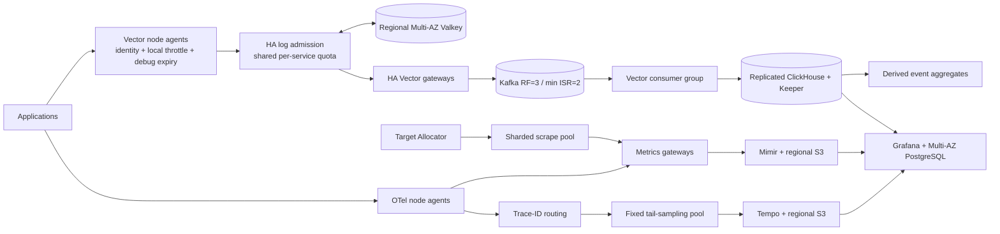

# Observability platform in a box

An AWS regional observability platform designed to contain noisy log producers. Vector handles logs; OpenTelemetry handles metrics and traces; Grafana provides a common investigation interface. Terraform builds independent three-AZ regions, and Helm installs the data plane and its controllers.

**The principal invariant: an error storm still consumes a service's log budget.** Adding collector replicas must not multiply that budget. A small admission service uses atomic Valkey token buckets between Vector agents and gateways. Quotas count events **and bytes**, and temporary debug collection receives a smaller sub-budget.



The [reference diagram](docs/reference/architecture.png) is preserved as input evidence. [Architecture and tradeoffs](docs/architecture.md) explain implementation differences. This is a tested implementation baseline, **not a claim of production or disaster-recovery certification**. See the precise [validation record](docs/validation.md).

## What is included

- Independent Terraform roots for `us-east-1` and `us-west-2`: private EKS 1.35, six initial on-demand nodes per region across three AZs, regional NAT, S3 gateway endpoint, encrypted storage, Pod Identity, Multi-AZ PostgreSQL and Valkey, cluster autoscaling, ownership tags, and separate locked state.
- Pinned Helm charts for operators, Kafka, ClickHouse/Keeper, Mimir, Tempo, Grafana, Vector, OTel agents/gateways, and scrape allocation. A separate namespace-scoped debug-grant controller propagates grants to replacement pods without restarting applications.
- Blue-green, manual promotion, and readiness analysis for log admission, Vector gateways, trace routers, and metrics gateways. Fixed trace samplers and quorum stores use state-aware upgrade procedures.
- Tests for real collector configuration, debug expiry, replica-independent shared quotas, error storms, byte budgets, request/concurrency bounds, CRD schemas, Terraform invariants, and a local Kafka-to-ClickHouse log pipeline.
- CI, an image-publishing workflow, debug grant/revoke automation, deployment scripts, regional value generation, guarded secret seeding, dashboards, and runbooks.

## Validate locally

Prerequisites: Python 3.11+, Go 1.25+, Terraform 1.10+, Helm 3.16+ (tested with Helm 4.2.3), Docker, OpenSSL, and kubeconform 0.7.0. Install kubeconform with `go install github.com/yannh/kubeconform/cmd/kubeconform@v0.7.0`.

```sh
make setup deps
make check
make terraform-init terraform-test
make runtime-test
make image integration-test
```

Checks do not apply Terraform or create AWS resources. The integration test creates and removes only containers and a network bearing its unique test identifier. Its one-broker/one-database topology verifies the data path, not three-AZ failover.

## Deploy a region

Already have EKS? Use the [existing-environment guide](docs/existing-clusters.md): bring an existing cluster and IAM roles, or reuse all AWS data services and install only the software. Controller and storage-class reuse are explicit, with a read-only preflight command before installation.

```sh
.venv/bin/python scripts/install.py --config build/existing.json \
  --quota-image REGISTRY/log-quota@sha256:YOUR_PUBLISHED_DIGEST --check-only
```

Remove `--check-only` to install after prerequisites pass. The configuration can be Terraform output or the [software-only example](examples/existing-platform.yaml). Supply real AZs; the installer no longer assumes `a/b/c`.

For a new region, follow [the runbook](docs/runbooks.md). Terraform planning/applying is a separate operator action. A private runner, AWS account, state bucket, administrative role, and published quota image digest are required. The installer checks the actual API endpoint and cluster identity and uses existing AWS/Kubernetes secret mechanisms; it never embeds real credentials in example values.

Start with one region, pass live acceptance, then repeat for the second. Bulk telemetry stays in its originating region. There is no automatic cross-region ingestion failover or raw-data replication by default.

## Enable debug collection for eight hours

Applications must emit structured JSON with `level` or `severity`, and their pods need a stable `observability/service` label. Label the application's namespace `observability/collect=true` to opt it into collection. The grant enables **collection** of emitted debug logs; it does not change an application's logger level.

```sh
helm upgrade --install debug-grants charts/debug-grants -n applications
python3 scripts/debug_grants.py grant --namespace applications --name checkout --hours 8
python3 scripts/debug_grants.py revoke --namespace applications --name checkout
```

The collector independently checks both grant timestamps against its clock, rejects malformed/future/overlong grants, and stops debug collection at expiry. The controller refreshes new pods every minute. See [debug grants and quota semantics](docs/quotas.md).

## Default budgets

| Control | Default | Scope |
|---|---:|---|
| Early log throttle | 500 events/s | Service per node; all levels |
| Log line limit | 32 KiB | Individual and merged lines; oversized lines dropped |
| Shared log quota | 1,000 events/s, 1 MiB/s | Service per region |
| Burst allowance | 2,000 events, 2 MiB | Service per region |
| Debug sub-budget | 100 events/s, 100 KiB/s | Within the service total |
| Debug collection | Off; grants up to 24 h | Workload, enforced at collection |
| Trace baseline | 10% | Tail-sampling candidates |
| Trace export ceiling | 2,000 spans/s | Sampler; three fixed samplers |
| Scrape interval / limit | 30 s / 10,000 samples | Per target |
| Retention | Logs 7 d; Kafka 24 h; metrics 15 d; traces 72 h | Regional backend |

Tune these using measured workload size. Error/slow trace preference is bounded, not a promise to preserve every error. Quota drops are intentional, counted loss. Buffer saturation, replay, failover, and upgrade limitations are documented rather than hidden.

## Pipeline hardening and operations through Git

Use `scripts/install.py --tuning examples/tuning.yaml` to override budgets, sampling, queues, cardinality and retention at deploy time. Arrow is enabled on supported collector links; `collectors.interconnect: otlp` is the explicit fallback. The shared Mimir series-drop policy also protects the scrape and OTLP paths without merging distinct counters.

[GitOps setup](docs/gitops.md) exports regional Flux releases so PRs reconcile pipelines, dashboards, saved queries, alert and recording rules. [Scaling operations](docs/scaling.md) covers each stage and [the adversarial review](docs/adversarial-review.md) explains fixes, quota scope and remaining limits. Run `make collector-test rules-test` for live Arrow/routing/cardinality and alert behavior tests, in addition to the existing checks.

Application metrics must identify their writer (`service.instance.id`, `k8s.pod.uid` or `k8s.node.name`) to avoid merging replicas. Use the [SDK identity fragment](examples/sdk-identity.yaml) with your application's SDK; namespaces must opt in with `observability/collect=true`. Anonymous-writer points are dropped by default and filter-drop telemetry makes that visible.
