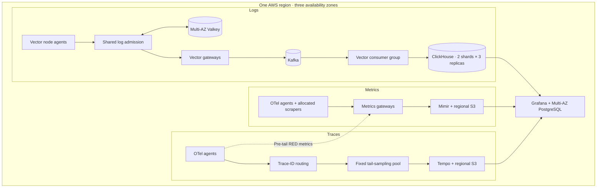

# Olly · Observability platform in a box

[](https://github.com/decimalst/obs-model/actions/workflows/ci.yaml)
[](LICENSE)

**Logs, metrics and traces on AWS—with shared log budgets, regional storage and infrastructure you can review in Git.**

Olly combines Terraform, Helm and a browser-based configuration studio to build an observability platform on new or existing EKS clusters. Vector handles logs, OpenTelemetry handles metrics and traces, and Grafana provides the investigation interface. Each region operates independently across three availability zones.

The design starts with one scaling problem: **an error storm must still consume the producing service's log budget.** A small admission service uses atomic Valkey token buckets between Vector agents and gateways. Event and byte limits are shared across admission replicas, and debug collection receives a smaller, expiring allowance. Scaling gateways does not create extra service budgets.

[Configure a deployment](#try-the-configuration-studio) · [Architecture](docs/architecture.md) · [Validation evidence](docs/validation.md) · [Deployment guide](docs/runbooks.md)

## What you get

| Capability | Included |
|---|---|
| Logs with bounded ingestion | Vector node agents and gateways, shared event/byte quotas, Kafka buffering, lag-scaled consumers and sharded ClickHouse storage |
| Metrics and traces | OTel Arrow on supported collector links, scrape allocation, Mimir, trace-ID routing, bounded tail sampling and Tempo |
| Service visibility | Grafana dashboards, pre-tail span-derived RED, optional service graphs, a Git-owned service catalog and Go application scaffolding |
| Infrastructure choices | New three-AZ EKS regions, existing clusters with managed data services, or software-only installation with explicit role/controller reuse |
| Operations through pull requests | Regional Flux releases, pipeline configuration, dashboards, queries, recording rules and alert definitions |
| Configuration studio | Seven-step setup, role-by-role IAM review, tuning, existing-resource ownership, file previews and downloadable configuration |
| Optional integrations | Externally owned Cilium Hubble, separate privileged CPU profiling to Pyroscope, privacy filters, SSO and Flink job scaffolding |

**Project status:** a tested implementation baseline with a successful, bounded AWS deployment rehearsal. Production HA, security and disaster recovery still require environment-specific qualification. See [what was tested](#what-has-been-tested) and [remaining work](docs/platform-gaps.md).

## Try the configuration studio

The studio needs only a local HTTP server. It generates files in your browser; no AWS credentials, cloud calls or automatic deployment are involved.

```sh
git clone https://github.com/decimalst/obs-model.git
cd obs-model
python3 -m http.server 8765 --bind 127.0.0.1 --directory site
```

Open **http://127.0.0.1:8765**. Choose an environment, review IAM roles, set capacity and visibility, then inspect and download the generated files. Save the request JSON to resume later; reloading closes the unsaved session.

New-cluster exports include Terraform configuration. Existing-cluster mode in the studio generates a **software-only** contract; the CLI also supports provisioning data services for existing EKS. The IAM review separates your existing Terraform identity, the EKS administrator grant and workload role creation or reuse. It never asks for credentials.

See [the studio guide](docs/configuration-studio.md) for offline CLI exports, advanced settings and optional GitHub Pages publication. The public build includes only an explicit static asset allowlist.

## Architecture



Telemetry remains in its originating region. Additional regions have separate ingestion, storage and state; cross-region replication and automatic ingestion failover are not enabled by default. Mimir uses a separate topic on the regional Kafka fleet. The [architecture guide](docs/architecture.md) covers that capacity coupling, optional components and differences from the preserved [reference diagram](docs/reference/architecture.png).

Blue-green releases apply to stateless admission, Vector gateways, metrics gateways and trace routers. Tail samplers keep stable membership and require a trace drain; Kafka, Keeper and ClickHouse follow quorum-aware procedures. Replica counts alone do not prove availability.

## Choose an installation path

| Starting point | Path and ownership |
|---|---|
| New AWS infrastructure | [Regional runbook](docs/runbooks.md): private EKS, six initial workers, regional storage, Multi-AZ PostgreSQL/Valkey and workload roles. Bring a state backend, authorized identity and private API access. |
| Existing EKS; new data services | [Existing-cluster Terraform](docs/existing-clusters.md): preserve the cluster and explicitly choose which services and roles Terraform owns. |
| Existing EKS and data services | [Software-only installation](docs/existing-clusters.md): use existing endpoints, buckets, roles, associations, Secrets, controllers and storage classes. No implicit adoption. |
| Disposable first AWS rehearsal | [Three-AZ lab](docs/aws-lab.md): private SSM runner, bounded worker capacity, stored-signal checks and a required teardown inventory. |

Start with the [setup options](docs/setup-options.md) and [IAM inventory](docs/iam.md). Review generated configuration, publish the quota image by immutable digest, then use the installer modes deliberately:

```sh
# Render and validate locally; no AWS or Kubernetes calls.
.venv/bin/python scripts/install.py --config build/platform.json \
  --quota-image REGISTRY/log-quota@sha256:YOUR_PUBLISHED_DIGEST --render-only

# Read-only checks against the selected AWS account and cluster.
.venv/bin/python scripts/install.py --config build/platform.json \
  --quota-image REGISTRY/log-quota@sha256:YOUR_PUBLISHED_DIGEST --check-only
```

Replace the placeholders with your reviewed contract and published image. Installation without either flag changes the selected cluster. Terraform plan/apply is a separate operator action. Follow the runbook for bootstrap order, secret preparation and acceptance; a raw Helm install is not the supported bootstrap path.

## Defaults you can tune

| Control | Default | Scope |
|---|---:|---|
| Early log throttle | 500 events/s | Namespace/service per node; all severities |
| Shared log quota | 1,000 events/s and 1 MiB/s | Namespace/service in one regional admission store |
| Shared burst | 2,000 events and 2 MiB | Same shared service bucket |
| Debug sub-budget | 100 events/s and 100 KiB/s | Within the total service budget |
| Debug collection | Off; grants up to 24 hours | Workload; expiry enforced by the collector |
| Kafka log pipeline | 36 partitions; 3–12 consumers | One stable consumer group, scaled by lag |
| ClickHouse | 2 write shards × 3 replicas | Three-AZ placement per shard; write quorum 2 |
| Trace sampling | 10% baseline candidates; bounded error/slow preference | Fixed three-sampler pool; 2,000 spans/s ceiling per sampler |
| Scraping | Every 30 seconds; 10,000 samples | Per target |
| Retention | Logs 7 days; Kafka 24 hours; metrics 15 days; traces 72 hours | Regional backends |

Use the studio for its supported settings or pass a validated [tuning file](examples/tuning.yaml) to the installer/GitOps compiler. Increasing an event limit does not remove the independent byte limit. These are protective defaults, not a throughput promise or a dollar cap; use the [cost and capacity model](docs/costs.md) before provisioning.

Applications opt into collection through namespace labels and stable service metadata. A temporary debug grant permits collection of **already emitted** debug logs; it does not change the application's logger level. See [quota and debug semantics](docs/quotas.md). Application metrics also need a [stable writer identity](examples/sdk-identity.yaml) so replica counters remain distinct.

## What has been tested

The [dated validation record](docs/validation.md#2026-09-25-authorized-disposable-aws-deployment) separates local tests from the September 25, 2026 AWS rehearsal in `us-east-2`:

- **Infrastructure:** 121 Terraform resources deployed, followed by a no-change plan; six workers across three AZs and two ClickHouse write shards with three replicas each.
- **Stored signals:** both canary replicas verified fresh logs, metrics and traces against ClickHouse, Mimir and Tempo.
- **Noisy neighbors:** all 30 quiet-service records reached storage alongside a 3,000-record ERROR flood. A separate isolated shared-quota burst offered 300 records, admitted 40, dropped 260 and stored all 40 accepted identities.
- **IAM and cleanup:** one Mimir Pod Identity bucket allow/deny probe passed. All lab AWS resources and retained cloud artifacts were removed; the final independent inventory was empty.

Bootstrap exposed synthetic-log loss before Kafka topic and ClickHouse schema readiness. The resulting [startup guards](docs/startup-gates.md) passed native local tests; **a fresh AWS cold start with those guards is still pending**. Live scaling, AZ/region failures, blue-green promotion, the complete IAM/security matrix and DR were not qualified. The [26-gate qualification catalog](docs/live-qualification.md) preserves those remaining checks.

The platform assumes trusted workload metadata and a protected platform namespace. Full internal TLS/authenticated tenancy needs the documented integration work. Delivery can duplicate or lose telemetry at the documented quota, buffer, failover and sampling boundaries; span-derived RED describes observed traffic, not guaranteed request accounting.

## Validate locally

CI pins Python 3.14, Go 1.25.8, Node 24.19.0, Terraform 1.15.8, Helm 4.2.3, kubectl 1.35.0 and kubeconform 0.7.0. You also need npm, Docker, Bash, Make and OpenSSL. Exact dependencies live in the [CI workflow](.github/workflows/ci.yaml), chart locks and Terraform provider locks. The installer also supports Helm 3.16.

```sh
go install github.com/yannh/kubeconform/cmd/kubeconform@v0.7.0
export PATH="$(go env GOPATH)/bin:$PATH"
make setup deps
make check
make terraform-init terraform-test
make runtime-test mimir-startup-test startup-gate-test
```

Run the additional pipeline/HA fixtures from [the testing guide](docs/testing.md) and the [contribution guide](CONTRIBUTING.md) for the components you change. Terraform tests use a mocked provider; native integration tests use disposable local containers. Validation targets never create AWS infrastructure. Initial setup downloads pinned dependencies and images.

## Documentation map

| Task | Guide |
|---|---|
| Understand design choices and limitations | [Architecture](docs/architecture.md) · [Adversarial review](docs/adversarial-review.md) · [Remaining gaps](docs/platform-gaps.md) |
| Deploy or reuse infrastructure | [Setup options](docs/setup-options.md) · [Existing EKS](docs/existing-clusters.md) · [IAM](docs/iam.md) · [Runbooks](docs/runbooks.md) |
| Reconcile pipelines and content from Git | [GitOps](docs/gitops.md) · [Service catalog and scaffolding](docs/service-catalog.md) |
| Scale ingestion and storage | [All tiers](docs/scaling.md) · [Kafka consumers](docs/kafka-consumers.md) · [ClickHouse sharding](docs/clickhouse-sharding.md) · [Costs](docs/costs.md) |
| Configure visibility and policy | [Service RED](docs/service-red.md) · [Privacy and graphs](docs/privacy-and-service-graphs.md) · [Hubble and CPU profiles](docs/ebpf.md) · [Security](docs/security.md) |
| Operate and qualify a deployment | [Support](docs/support.md) · [Recovery](docs/recovery.md) · [AWS lab](docs/aws-lab.md) · [Test evidence](docs/validation.md) |

Contributions are welcome through reviewed pull requests. Read [CONTRIBUTING.md](CONTRIBUTING.md) for setup and relevant tests, and [SECURITY.md](SECURITY.md) for reporting guidance. Released under the [MIT license](LICENSE); included third-party components retain their own licenses.
