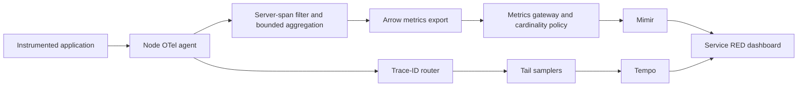

# Service RED from spans

The **Service RED — observed traffic** Grafana dashboard provides request rate, error ratio, error rate, and p50/p95/p99 duration. Filters select region, cluster, service namespace, service name and span kind. A trace panel searches retained error traces. Dashboard JSON and recording/overflow-alert rules are provisioned from Git and reconciled with the platform release.

## Data path and counting contract



A separate agent receiver branch feeds `spanmetrics/red` before tail sampling. The trace branch keeps its original spans. Counting occurs once at collection, not again at gateways or Tempo. Agent metrics use the agent Pod UID as `service.instance.id`; application replicas' resource identities do not create competing writers. Prometheus stores those streams separately, and recording rules sum their rates. Histogram quantiles are calculated after adding bucket rates across writers, never by averaging pod quantiles.

By default, only `SERVER` spans count. CLIENT and INTERNAL spans would count extra work within a request and are excluded. `CONSUMER` spans can be enabled for asynchronous workers, but select that span kind separately in the dashboard. Missing, empty, non-string or overlong service names are excluded from RED generation. An OTel ERROR status counts as an error; integer HTTP status attributes in the 500–599 range also count. Server 4xx responses count as errors only when the span explicitly reports ERROR. Durations use explicit histogram buckets in seconds. Applications must produce valid server spans, propagate context and set meaningful status codes.

These are **observed-span metrics**, not guaranteed request accounting. Full incoming RED coverage requires all relevant application spans to reach the agent. SDK head sampling, retries, duplicate instrumentation, dropped input, agent failures, counter/cache resets and exporter outages affect counts. The RED branch clears tracestate before aggregation to disable sampling-threshold extrapolation; it never applies a blanket `1/samplingPercent` correction. Existing trace-state and status fields remain intact in stored traces. Startup and short windows can undercount before two counter samples arrive. Use direct application metrics for contractual SLOs or billing.

Metrics include requests whose traces are subsequently dropped. The error-trace panel therefore cannot reconstruct every counted error, and HTTP 5xx spans whose original status is unset are not necessarily selected by the tail sampler's ERROR policy. Exemplars are disabled to avoid promising a retained trace for every metric observation. A healthy error rate becomes zero only when request traffic exists; idle or absent telemetry does not become a fabricated healthy error ratio.

## Bounded and configurable

```yaml
spanMetrics:
  enabled: true
  spanKinds: [SERVER]
  includeHttpRoute: false
  aggregationCardinalityLimit: 64
  resourceMetricsCacheSize: 128
  flushIntervalSeconds: 15
  expirationSeconds: 300
  histogramBucketsSeconds: [0.005, 0.01, 0.025, 0.05, 0.1, 0.25, 0.5, 1, 2.5, 5, 10]
```

Pass these fields through installer `--tuning` or regional HelmRelease values. The chart and installer reject zero/unbounded limits, invalid span kinds, non-increasing buckets and expiration shorter than two flush intervals. Turning the feature off removes its collector branches and dashboard and empties its rule group while preserving the projected rule file.

No span name, raw URL, SQL, request ID, user ID, event attributes or arbitrary resource attributes become labels. Only a fixed resource allowlist survives on the RED branch. The optional `http.route` dimension must contain an instrumentation-supplied route template, never a raw request path; long or invalid routes become `unknown`. The dashboard's default panels aggregate routes to service level.

`aggregationCardinalityLimit` is **per resource group per agent**. Resource groups are service, namespace, region, cluster and agent writer. `resourceMetricsCacheSize` controls cached groups; evicted state can persist until a flush. These controls are not a hard tenant-wide series or memory quota. The collector memory limiter and existing Mimir series/ingestion caps remain necessary. With B finite histogram buckets, a normal dimension combination expands to approximately B+4 Prometheus series (counter, B+1 buckets, sum, count), multiplied by active writers. Enabling routes can increase cost rapidly.

Additional combinations become an `otel_metric_overflow="true"` stream. They are excluded from service RED summaries and trigger `SpanMetricsCardinalityOverflow`; the dashboard shows their volume. Treat that as incomplete service attribution and repair dimensions or deliberately size the budget. Resource-cache churn, refused spans and metric export failures also require investigation; overflow alone does not detect all lost telemetry.

## Onboard an application

1. Install or enable the application's OpenTelemetry SDK/automatic instrumentation. Infrastructure alone cannot discover business operations or install a language SDK into an existing process.
2. Merge [the SDK identity fragment](../examples/sdk-identity.yaml) into the Pod template and change the service name. It supplies the local agent endpoint, application writer identity and full trace emission. Namespace opt-in is explicit: label the namespace `observability/collect=true`. Configure the application's logger separately; Vector collects container JSON logs.
3. Send a known request, error and slow request. Check the RED dashboard after several flushes and a ruler evaluation. Validate service identity, expected error semantics and units. Compare against direct application counters before treating RED as an operational baseline.
4. Verify an emitted trace reaches Tempo and a correlated structured log reaches ClickHouse. Grafana's trace panel sees only retained traces. Adopt service ownership, alert routing and an SLO definition before enabling service-specific paging.

For 0.3 → 0.4 upgrades, agents roll one node at a time and begin new metric streams. There is no trace-history backfill. Memory/CPU work increases on node agents; size `resources.agents` using representative traffic. Reverting or disabling removes future production of these metrics but does not delete historical series from Mimir. Do not casually change histogram buckets while multiple versions run: mixed bucket schemas can distort aggregate quantiles until old samples leave the rate window. Roll out a new metric namespace or coordinate a complete change and wait for the old window to expire.

## Verification

`make red-test` uses the pinned collectors, two independent agents, Arrow links, the production metric gateway/remote-write exporter, three tail samplers and a local Prometheus sink. It checks exact request/error/histogram totals, distinct writers, original-trace preservation, healthy tail sampling at 0%, and optional route overflow. Prometheus substitutes for Mimir and trace sinks are files; AWS storage integration is not inferred. `make rules-test` verifies aggregation, quantiles, healthy/idle/missing-data behavior and overflow alerts. `make dashboard-test` verifies file provisioning/reload in the pinned Grafana image; browser layout and live datasource wiring still require cluster acceptance.

The pinned OpenTelemetry spanmetrics connector is alpha. Pinning and executable tests reduce upgrade risk; they do not make it a stable API. Requalify emitted names, units, status labels, writer identities and sampling behavior before upgrading. Sources: [connector configuration](https://github.com/open-telemetry/opentelemetry-collector-contrib/blob/v0.148.0/connector/spanmetricsconnector/README.md), [aggregation, resource grouping and status behavior](https://github.com/open-telemetry/opentelemetry-collector-contrib/blob/v0.148.0/connector/spanmetricsconnector/connector.go).
